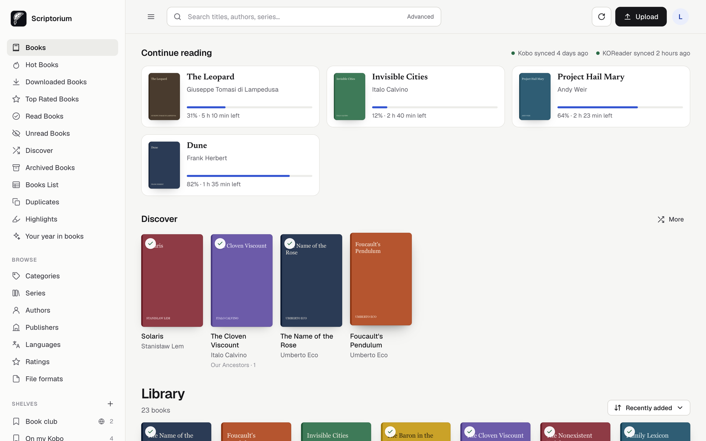
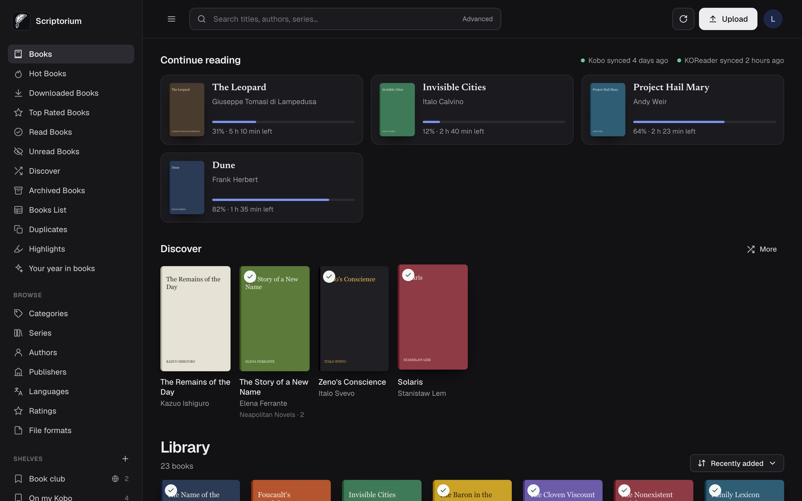
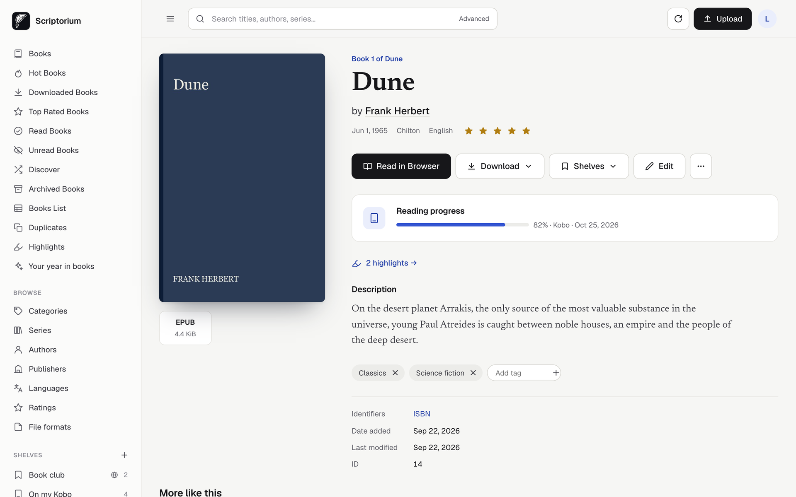
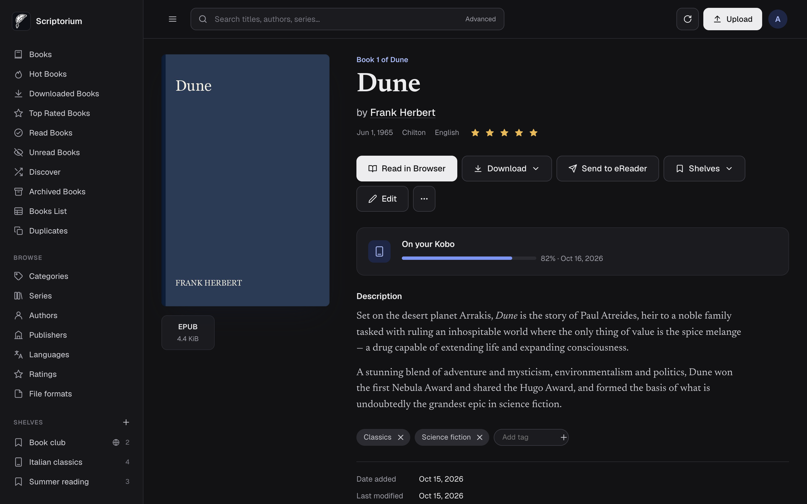
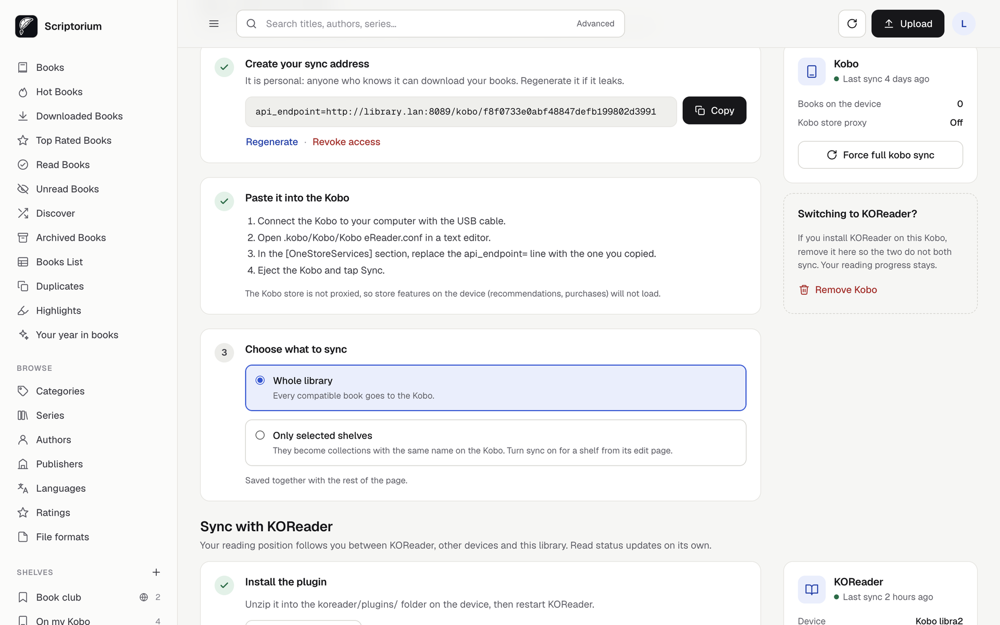
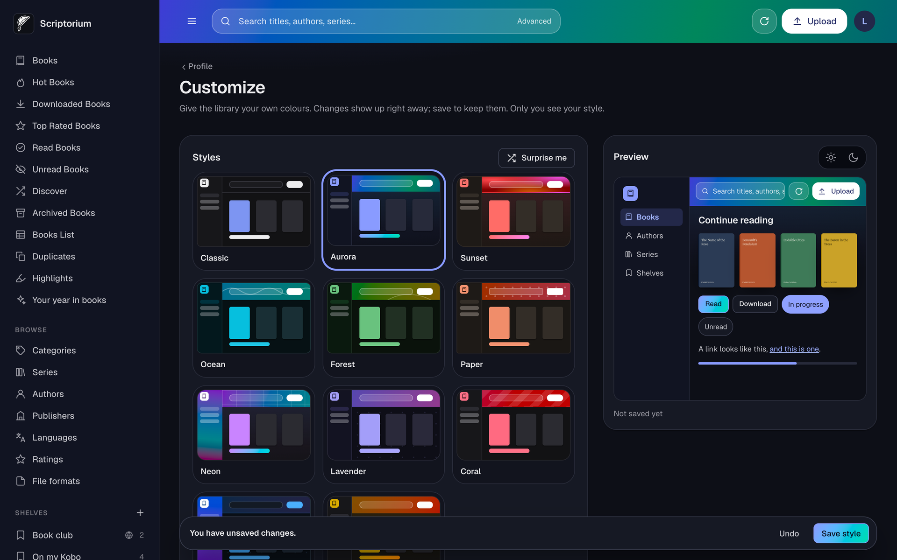

<p align="center">
  
</p>

<h1 align="center">Scriptorium</h1>

<p align="center">
  <strong>A self-hosted library that tends itself.</strong><br>
  Drop in a book — it's imported, converted, tagged and on your Kobo by the next sync.<br>
  Beautiful to browse, effortless to keep, yours to run.
</p>

<p align="center">
  <a href="#quick-start">Quick start</a> ·
  <a href="#migrating-from-calibre-web-automated">Migrate from CWA</a> ·
  <a href="docs/kobo.md">Kobo</a> ·
  <a href="docs/installation.md">Docs</a> ·
  <a href="#credits">Credits</a>
</p>

---

## Fork of Calibre-Web-Automated

Scriptorium is a fork of [Calibre-Web-Automated](https://github.com/crocodilestick/Calibre-Web-Automated)
(CWA), itself built on [Calibre-Web](https://github.com/janeczku/calibre-web) and
[Calibre](https://calibre-ebook.com). It is based on CWA **v4.0.8**.

**What changes — the whole front end.**
- A new interface, redesigned page by page: library, book pages, shelves, search, settings,
  statistics and admin tools, with light and dark mode and a layout that works on a phone.
- New readers: an EPUB reader with themes and typography settings, an audiobook player that
  resumes where you stopped, refreshed comic, PDF and plain-text readers.
- A guided Kobo setup on your profile, and a "Continue reading" view fed by your devices.
- **Personal styles**: every reader can give the interface their own colours from *Customize* —
  ready-made themes, a random mix or a hand-picked palette, with a live preview.
- Security hardening: a strict Content-Security-Policy with no inline scripts, CSRF on every action,
  safer redirects and uploads, sanitised descriptions, regression tests.
- A complete Italian translation, and readable guides in [`docs/`](docs).

**What stays the same — everything underneath.**
- The backend, the automation services (ingest, conversion, metadata, duplicates, EPUB fixer,
  backups), Kobo and KOReader sync, OPDS, users and permissions.
- The data: `app.db`, `cwa.db`, your Calibre library, the container paths and the environment
  variables. A CWA install can switch to Scriptorium and back
  ([details](#migrating-from-calibre-web-automated)).

## Screenshots

| Light | Dark |
| --- | --- |
|  |  |
|  |  |
|  |  |

## Quick start

You need [Docker](https://docs.docker.com/get-docker/) with the Compose plugin.

```bash
mkdir scriptorium && cd scriptorium
curl -O https://raw.githubusercontent.com/Mrcoloo/scriptorium-library/main/docker-compose.yml
docker compose up -d
```

Open **http://localhost:8083** (or your server's address) and sign in with `admin` / `admin123`.
Scriptorium asks you to choose a new password straight away.

That's it. Drop a book into the `ingest` folder next to the compose file and watch it appear in your
library. The compose file looks like this:

```yaml
services:
  scriptorium:
    image: ghcr.io/mrcoloo/scriptorium-library:latest
    container_name: scriptorium
    environment:
      - PUID=1000        # run `id -u` to find yours
      - PGID=1000        # run `id -g` to find yours
      - TZ=Europe/London
    volumes:
      - ./config:/config                  # settings, users, logs, backups
      - ./ingest:/cwa-book-ingest         # drop books here; files are removed after import
      - ./library:/calibre-library        # your Calibre library (created if empty)
    ports:
      - 8083:8083
    restart: unless-stopped
```

Next steps: pick your target format in *Settings → Automation* (KEPUB if you read on a Kobo), then
connect your e-reader — [Kobo](docs/kobo.md) or [KOReader](docs/koreader.md).

## Configuration

### Volumes

| Container path | What it holds |
| --- | --- |
| `/config` | `app.db` (users, settings, reading progress), `cwa.db` (automation settings, statistics), logs, profile pictures, backups in `processed_books/`. **Back this up.** |
| `/cwa-book-ingest` | Drop zone. Supported files are imported and then **deleted** from here. Copy finished files in; don't download into it. |
| `/calibre-library` | Your Calibre library (`metadata.db` and book folders). Empty → a new library is created. Several → the largest is used. |
| `/config/.config/calibre/plugins` | Optional: Calibre plugins used during conversion. |

The container paths keep their CWA names (`/cwa-book-ingest`, `cwa.db`) on purpose, so existing
setups keep working. Change only the left-hand side of each mapping.

### Environment variables

| Variable | Default | Purpose |
| --- | --- | --- |
| `PUID` / `PGID` | `1000` | Owner of the files written to your volumes. |
| `TZ` | `UTC` | Time zone for schedules and timestamps, e.g. `Europe/Rome`. |
| `CWA_PORT_OVERRIDE` | `8083` | Port the web server listens on inside the container. |
| `HARDCOVER_TOKEN` | – | API key for [Hardcover](https://hardcover.app) as a metadata provider (also settable in the UI). |
| `NETWORK_SHARE_MODE` | `false` | `true` when the library or config live on NFS/SMB: safer SQLite settings, polling instead of inotify. |
| `CWA_WATCH_MODE` | `inotify` | `poll` forces polling for new files. |
| `TRUSTED_PROXY_COUNT` | `1` | Number of reverse proxies in front of Scriptorium. |
| `DISABLE_LIBRARY_AUTOMOUNT` | `false` | `true` skips automatic library detection at start-up. |

More on reverse proxies, network shares and permissions in the
[installation guide](docs/installation.md).

### Updating

```bash
docker compose pull
docker compose up -d
```

Administrators see a notice in the interface when a new release is out. To stay on a specific
version, replace `latest` with a release tag such as `ghcr.io/mrcoloo/scriptorium-library:v1.0.0`.

### Backup

Everything that matters lives in two folders: `config` and `library`. Stop the container for a
consistent copy:

```bash
docker compose stop
tar czf scriptorium-backup-$(date +%F).tar.gz config library
docker compose start
```

To restore, extract the archive in place of the two folders and start the container again.
Imported, converted and repaired originals are also kept in `config/processed_books/` when the
automatic backups are on (*Settings → Automation → Backups*).

## Migrating from Calibre-Web-Automated

Scriptorium reads and writes the same data as CWA v4.0.8, so switching is an image swap:

1. Back up your `config` and `library` folders (see [Backup](#backup)).
2. In your existing compose file, change only the image:
   `image: ghcr.io/mrcoloo/scriptorium-library:latest`. Keep the volumes, ports and environment
   variables as they are.
3. `docker compose up -d`.

What we checked in the code, honestly:
- **No database changes.** Scriptorium adds no tables or columns to `app.db`, `cwa.db` or
  `metadata.db`. Your users, shelves, smart shelves, reading progress, Kobo and KOReader sync state
  carry over, and you can switch back to CWA the same way.
- **Kobo and KOReader keep working.** The Kobo sync address and the KOReader plugin's endpoint are
  unchanged. Re-downloading the KOReader plugin is optional; it only changes its display name.
- **Personal styles** are stored inside the user's existing view settings; CWA simply ignores them.
- **Default password.** If an account still uses `admin123`, Scriptorium asks for a new password
  at the next sign-in.
- **Your instance title is kept.** To show "Scriptorium" in the header, change it in
  *Settings → Interface*.
- **Newer CWA versions.** Scriptorium is based on CWA v4.0.8. If you run a later CWA release that
  changed the database, moving to Scriptorium has not been tested; keep your backup at hand.

Coming from plain Calibre-Web? See [the installation guide](docs/installation.md#migrating-from-calibre-web).

## Documentation

| Guide | |
| --- | --- |
| [Installation](docs/installation.md) | Volumes, environment variables, network shares, reverse proxies |
| [Kobo](docs/kobo.md) | Sync setup, choosing what to sync, troubleshooting |
| [KOReader](docs/koreader.md) | Progress sync plugin |
| [Automation](docs/automation.md) | Ingest, conversion, metadata, duplicates, EPUB fixer, backups |
| [Security](docs/security.md) | Deploying safely and how the app is hardened |
| [Development](docs/development.md) | Running from source, tests, front-end conventions, translations |

## Contributing

Bug reports, ideas and pull requests are welcome — start with [CONTRIBUTING.md](CONTRIBUTING.md).
Backend fixes that also apply to Calibre-Web-Automated are best proposed
[upstream](https://github.com/crocodilestick/Calibre-Web-Automated) too, so both projects benefit.
Security issues: please follow [SECURITY.md](SECURITY.md).

## License

Scriptorium is free software under the [GNU General Public License v3.0 or later](LICENSE). Like
its upstream projects, it comes with no warranty. Source files keep their original copyright
notices; see [NOTICE](NOTICE) and [CONTRIBUTORS](CONTRIBUTORS).

## Credits

Scriptorium stands on the work of three projects and their contributors:

- **[Calibre-Web-Automated](https://github.com/crocodilestick/Calibre-Web-Automated)** by
  crocodilestick and contributors — the automation, Kobo and KOReader sync, duplicates, statistics
  and much more that Scriptorium builds on.
- **[Calibre-Web](https://github.com/janeczku/calibre-web)** by janeczku and contributors — the web
  library at the core.
- **[Calibre](https://calibre-ebook.com)** by Kovid Goyal and contributors — conversion and metadata.

Third-party libraries and fonts are listed in [NOTICE](NOTICE).
