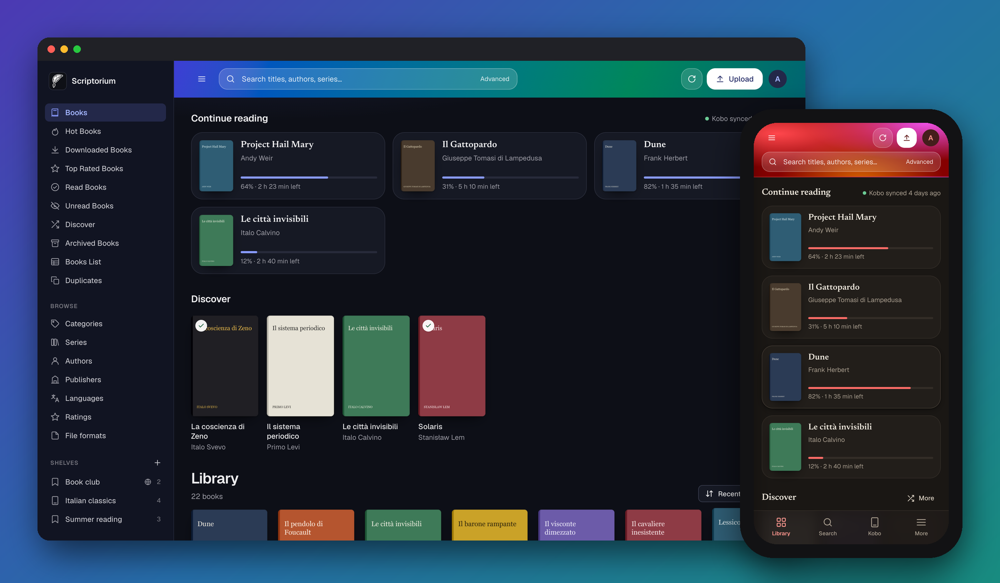
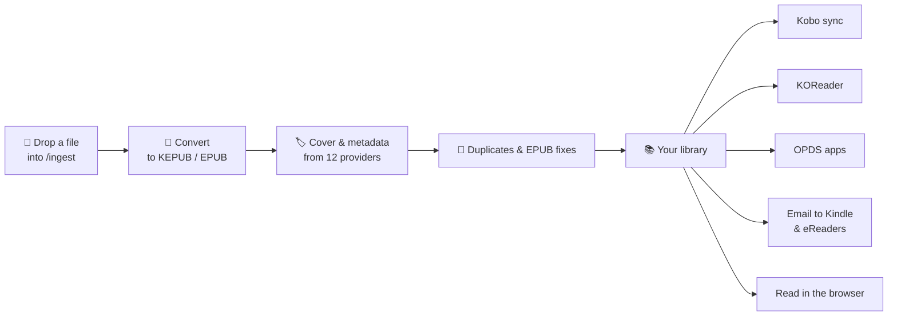
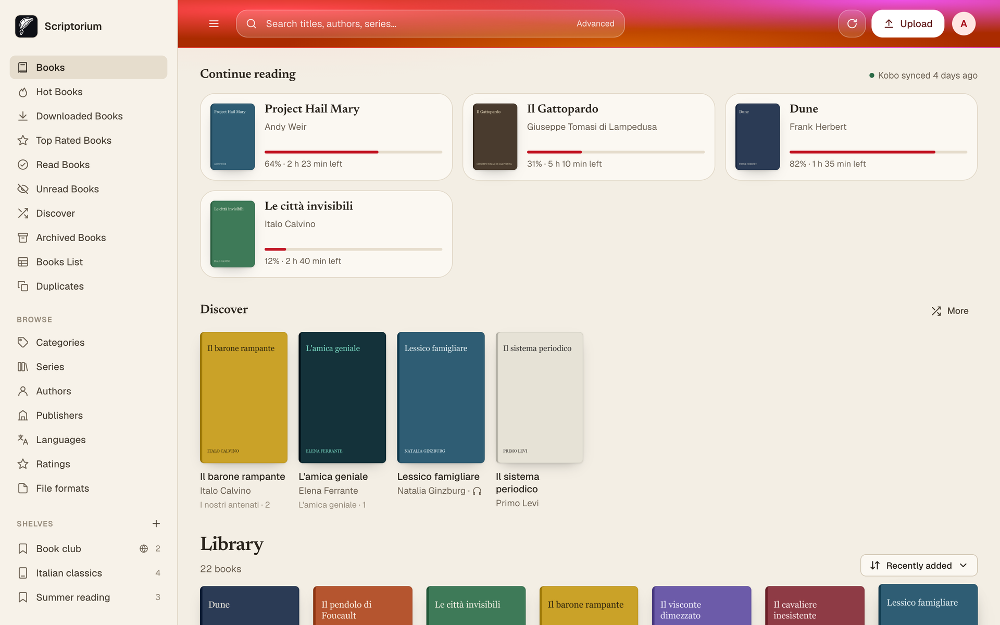
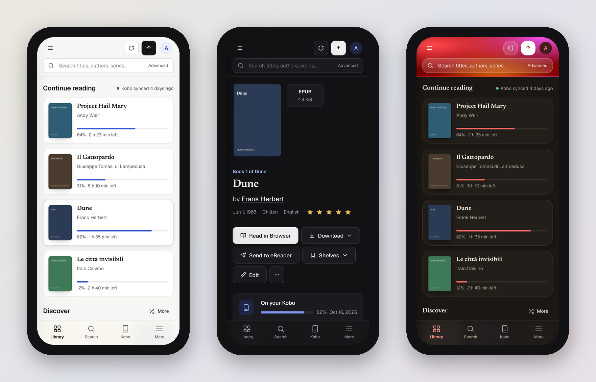

<p align="center">
  
</p>

<h1 align="center">Scriptorium</h1>

<p align="center">
  <strong>The self-hosted library that tends itself.</strong><br>
  Drop in a book. Scriptorium imports it, converts it, finds its cover and metadata,<br>
  and puts it on your Kobo by the next sync. You just read.
</p>

<p align="center">
  <a href="#quick-start"></a>
  
  <a href="docs/kobo.md"></a>
  <a href="LICENSE"></a>
</p>

<p align="center">
  <a href="#quick-start"><b>Quick start</b></a> ·
  <a href="#features">Features</a> ·
  <a href="#screenshots">Screenshots</a> ·
  <a href="docs/installation.md">Docs</a> ·
  <a href="#coming-from-calibre-web-automated">Coming from CWA?</a>
</p>

<p align="center">
  
</p>

---

## Why Scriptorium

Most ebook servers are file browsers with a login page. Scriptorium is a **library that keeps
itself in order** and **a place you actually enjoy opening**.

<table>
  <tr>
    <td width="33%" valign="top">
      <h3>📥&nbsp;Drop it in, forget it</h3>
      Copy a file into one folder. Scriptorium imports it, converts it to the format your reader
      wants, fetches cover and metadata, catches duplicates and repairs EPUBs that Amazon would
      reject. All automatically.
    </td>
    <td width="33%" valign="top">
      <h3>📖&nbsp;Kobo-first, not Kobo-also</h3>
      Paste one line on your Kobo and your library, shelves and reading progress stay in step,
      with no cables and no Calibre desktop app. KOReader, OPDS apps and Send-to-Kindle work too.
    </td>
    <td width="33%" valign="top">
      <h3>🎨&nbsp;Beautiful, and yours</h3>
      A clean, fast interface in light and dark, built for phones as much as desktops. Every
      reader can give it their own colours, from a pre-made theme, a random mix or a hand-tuned palette.
    </td>
  </tr>
</table>

## Quick start

All you need is [Docker](https://docs.docker.com/get-docker/) with the Compose plugin.

```bash
mkdir scriptorium && cd scriptorium
curl -O https://raw.githubusercontent.com/MrColoo/scriptorium-library/main/docker-compose.yml
docker compose up -d
```

Open **http://localhost:8083** and sign in with `admin` / `admin123`. You'll be asked to choose a
new password right away.

Now drop an EPUB, PDF, MOBI or any other ebook into the `ingest` folder next to the compose file
and watch it appear in your library. Then [connect your Kobo](docs/kobo.md); it takes about
two minutes.

<details>
<summary><b>What's in <code>docker-compose.yml</code></b></summary>

```yaml
services:
  scriptorium:
    image: ghcr.io/mrcoloo/scriptorium-library:latest
    container_name: scriptorium
    environment:
      - PUID=1000        # run `id -u` to find yours
      - PGID=1000        # run `id -g` to find yours
      - TZ=Europe/London
    volumes:
      - ./config:/config                  # settings, users, logs, backups
      - ./ingest:/cwa-book-ingest         # drop books here; files are removed after import
      - ./library:/calibre-library        # your Calibre library (created if empty)
    ports:
      - 8083:8083
    restart: unless-stopped
```

Already have a Calibre library? Point `./library` at it. Scriptorium uses it as it is.
</details>

## How it works



Your books live in a standard Calibre library, so you can open it with Calibre desktop at any
time. Nothing is locked in.

## Features

**Automation**
- **Auto-import** from a watched folder, with web upload too. Works on NFS/SMB shares.
- **Conversion** to your target format (KEPUB for Kobo, EPUB for everything else), plus a
  one-click run for the whole library.
- **Metadata and covers** from Google Books, Hardcover, Amazon, ComicVine, Kobo, DNB and more.
  Fields are only replaced when the new value is better.
- **Duplicate detection** with previews, merging and optional automatic resolution.
- **EPUB fixer** that repairs the small errors Send-to-Kindle rejects.
- **Automatic backups** of every original before it's touched.

**Reading**
- **Kobo sync**: books, shelves as collections, reading progress and a guided setup on your profile.
- **KOReader sync** plugin for Kindle, PocketBook, Android and jailbroken devices.
- **Continue reading** on the home page, fed by your devices, with time left in each book.
- **Built-in readers**: EPUB with themes and typography settings, comics, PDF and plain text, plus an
  audiobook player that remembers where you stopped.
- **OPDS** catalogue for apps like KyBook, Moon+ Reader and Panels.
- **Send to eReader** by email, automatically for new books if you like.

**Library**
- **Shelves and smart shelves** that fill themselves from rules (for example "unread sci-fi" or "added since June").
- **Multi-user** with permissions, per-user Kobo devices, LDAP, OAuth and generic OIDC sign-in.
- **Reading statistics**, and an activity log for administrators.
- **28 languages**.

**Interface**
- Designed page by page, light and dark, **fully usable on a phone** with a bottom navigation bar.
- **Personal styles**: eleven themes, a "Surprise me" button and a palette editor, with a live preview.
- **Security by default**: a strict Content-Security-Policy with no inline scripts, CSRF on every
  action and a password change forced at first login. [More](docs/security.md)

## Screenshots

<p align="center">
  <picture>
    <source media="(prefers-color-scheme: dark)" srcset="docs/screenshots/library-dark.png">
    
  </picture>
  <br><sub><b>Home</b> — what you're reading on your Kobo, something to discover, and the whole library. It follows your light or dark theme.</sub>
</p>

<table>
  <tr>
    <td width="50%">
      <picture>
        <source media="(prefers-color-scheme: dark)" srcset="docs/screenshots/book-dark.png">
        
      </picture>
      <p align="center"><sub><b>Book page</b> — read, download, send or shelve in one click</sub></p>
    </td>
    <td width="50%">
      <picture>
        <source media="(prefers-color-scheme: dark)" srcset="docs/screenshots/kobo-dark.png">
        
      </picture>
      <p align="center"><sub><b>Kobo setup</b> — one address to paste, guided step by step</sub></p>
    </td>
  </tr>
  <tr>
    <td width="50%">
      
      <p align="center"><sub><b>Customize</b> — ready-made styles with a live preview</sub></p>
    </td>
    <td width="50%">
      
      <p align="center"><sub><b>Sunset style</b> — each reader picks their own look</sub></p>
    </td>
  </tr>
</table>

<p align="center">
  
  <br><sub><b>On your phone</b> — the same library, built for one hand</sub>
</p>

## Configuration

### Volumes

| Container path | What it holds |
| --- | --- |
| `/config` | `app.db` (users, settings, reading progress), `cwa.db` (automation settings, statistics), logs, profile pictures, backups in `processed_books/`. **Back this up.** |
| `/cwa-book-ingest` | Drop zone. Supported files are imported and then **deleted** from here. Copy finished files in; don't download into it. |
| `/calibre-library` | Your Calibre library (`metadata.db` and book folders). If it's empty, a new library is created. If there are several, the largest is used. |
| `/config/.config/calibre/plugins` | Optional: Calibre plugins used during conversion. |

### Environment variables

| Variable | Default | Purpose |
| --- | --- | --- |
| `PUID` / `PGID` | `1000` | Owner of the files written to your volumes. |
| `TZ` | `UTC` | Time zone for schedules and timestamps, e.g. `Europe/Rome`. |
| `CWA_PORT_OVERRIDE` | `8083` | Port the web server listens on inside the container. |
| `HARDCOVER_TOKEN` | – | API key for [Hardcover](https://hardcover.app) as a metadata provider (also settable in the UI). |
| `NETWORK_SHARE_MODE` | `false` | `true` when the library or config live on NFS/SMB: safer SQLite settings, polling instead of inotify. |
| `CWA_WATCH_MODE` | `inotify` | `poll` forces polling for new files. |
| `TRUSTED_PROXY_COUNT` | `1` | Number of reverse proxies in front of Scriptorium. |
| `DISABLE_LIBRARY_AUTOMOUNT` | `false` | `true` skips automatic library detection at start-up. |

Reverse proxies, network shares and permissions are covered in the
[installation guide](docs/installation.md).

### Updating

```bash
docker compose pull && docker compose up -d
```

Administrators see a notice in the interface when a new release is out. To pin a version, use a
release tag such as `ghcr.io/mrcoloo/scriptorium-library:v1.0.0` instead of `latest`.

### Backup

Everything that matters lives in two folders, `config` and `library`. Stop the container to get
a consistent copy:

```bash
docker compose stop
tar czf scriptorium-backup-$(date +%F).tar.gz config library
docker compose start
```

To restore, extract the archive in place of the two folders and start the container again.

## Coming from Calibre-Web-Automated

Scriptorium is built on [Calibre-Web-Automated](https://github.com/crocodilestick/Calibre-Web-Automated)
v4.0.8 and reads and writes exactly the same data, so switching is an image swap:

1. Back up your `config` and `library` folders ([how](#backup)).
2. In your compose file, change only the image to `ghcr.io/mrcoloo/scriptorium-library:latest`.
   Keep the volumes, ports and environment variables as they are.
3. Run `docker compose up -d`.

What carries over, and what to know:
- **No database changes.** Scriptorium adds no tables or columns. Users, shelves, smart shelves,
  reading progress and Kobo and KOReader sync state all carry over, and you can switch back the
  same way.
- **Your devices keep working.** The Kobo sync address and the KOReader endpoint are unchanged.
  Re-downloading the KOReader plugin is optional; the new version only changes its display name.
- **Personal styles** are stored inside each user's existing view settings. CWA simply ignores them.
- **Your instance title is kept.** To show "Scriptorium" in the header, change it in
  *Settings → Interface*.
- **Newer CWA releases** that changed the database have not been tested. Keep your backup at hand.

Coming from plain Calibre-Web? See [the installation guide](docs/installation.md#migrating-from-calibre-web).

## Documentation

| Guide | |
| --- | --- |
| [Installation](docs/installation.md) | Volumes, environment variables, network shares, reverse proxies |
| [Kobo](docs/kobo.md) | Sync setup, choosing what to sync, troubleshooting |
| [KOReader](docs/koreader.md) | Progress sync plugin |
| [Automation](docs/automation.md) | Ingest, conversion, metadata, duplicates, EPUB fixer, backups |
| [Security](docs/security.md) | Deploying safely and how the app is hardened |
| [Development](docs/development.md) | Running from source, tests, front-end conventions, translations |

## Contributing

Bug reports, ideas, translations and pull requests are welcome. Start with
[CONTRIBUTING.md](CONTRIBUTING.md). Backend fixes that also apply to Calibre-Web-Automated are
best proposed [upstream](https://github.com/crocodilestick/Calibre-Web-Automated) too, so both
projects benefit. To report a security issue, please follow [SECURITY.md](SECURITY.md).

## Credits

Scriptorium stands on the shoulders of three projects and their contributors:

- **[Calibre-Web-Automated](https://github.com/crocodilestick/Calibre-Web-Automated)** by
  crocodilestick and contributors: the automation, Kobo and KOReader sync, duplicates, statistics
  and much more that Scriptorium builds on.
- **[Calibre-Web](https://github.com/janeczku/calibre-web)** by janeczku and contributors: the web
  library at the core.
- **[Calibre](https://calibre-ebook.com)** by Kovid Goyal and contributors: conversion and metadata.

Scriptorium redesigns the whole interface and readers, adds personal styles and hardens
security. The backend stays close to upstream so fixes can flow both ways.

## License

Scriptorium is free software under the [GNU General Public License v3.0 or later](LICENSE) and
comes with no warranty. Source files keep their original copyright notices. Third-party
libraries and fonts are listed in [NOTICE](NOTICE) and [CONTRIBUTORS](CONTRIBUTORS).
