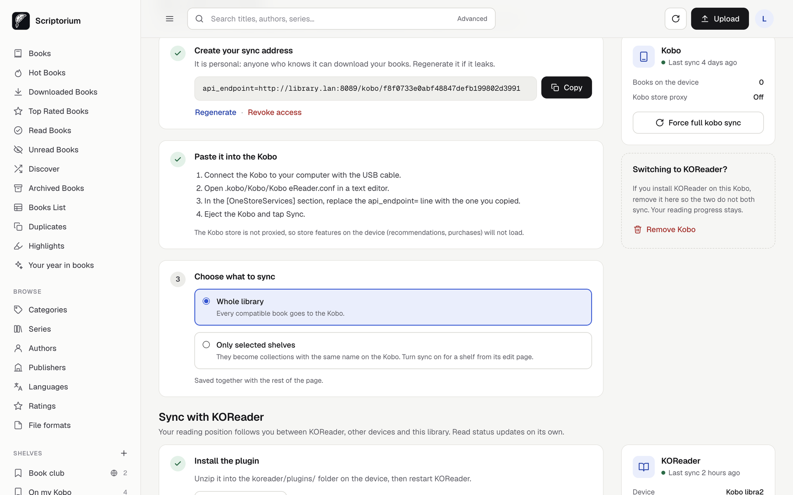

# Kobo

Scriptorium can stand in for the Kobo Store as your device's sync server. After a one-time setup,
tapping **Sync** on the Kobo downloads new books, removes the ones you take off, creates collections
from your shelves and sends your reading progress and highlights back to the library. No cables and
no Calibre.

You will edit one line in a text file on the Kobo. It takes about two minutes, and it is fully
reversible.

## Before you start

Your Kobo must be able to reach your server **at the moment it syncs**.

- **At home** it just needs the server's LAN address, such as `http://192.168.1.50:8083`. Reserve
  that address on your router so it never changes ([how](start-here.md#step-7-reach-it-from-your-other-devices)).
- **Away from home** it needs a public address. The Kobo cannot join a VPN such as Tailscale, so to
  sync outside your home you need [a reverse proxy or tunnel](remote-access.md). Syncing at home
  only is perfectly fine: your books stay on the device.

## 1. Turn it on (administrator)

Open *Settings → Server & features → Kobo* and turn on **Enable Kobo sync**.

Two more options live here:

- **Proxy unknown requests to Kobo Store** passes everything Scriptorium does not handle on to
  Kobo, which keeps the store working on the device: recommendations, purchases and your Kobo
  account. It is off by default. Turn it on if you still buy from Kobo.
- **Server External Port** is only needed when the Kobo reaches Scriptorium on a different port than
  your browser does, for example through a port forward.

For the best experience, also set *Settings → Automation → Conversion → target format* to **KEPUB**.
You get page numbers, reading statistics and faster page turns. EPUB books still sync: they are
converted to KEPUB as the Kobo downloads them.

## 2. Create your sync address (every user)

Open *Profile → Devices*, make sure **Kobo** is on, and press **Create sync address**.

> [!IMPORTANT]
> Open this page from an address the Kobo can reach, such as your server's LAN IP or domain, **not**
> `localhost`. The sync address is built from the one in your browser. Scriptorium warns you if it
> looks wrong.

The address is personal: anyone who has it can download your books. If it leaks, press
**Regenerate** and paste the new one into the Kobo. **Revoke access** cuts the device off.



## 3. Paste it into the Kobo

1. Connect the Kobo to your computer with the USB cable.
2. Open `.kobo/Kobo/Kobo eReader.conf` in a plain-text editor such as Notepad or TextEdit.
   - `.kobo` is a hidden folder. On macOS, press `⌘⇧.` in Finder to show it. On Windows, turn on
     *Hidden items* in the File Explorer *View* menu.
3. In the `[OneStoreServices]` section, replace the `api_endpoint=` line with the one you copied.
   Keep a copy of the old line if you may want to go back.
4. Save, eject the Kobo and tap **Sync**.

The Devices page then shows when the device last synced and how many books it has.

## Choosing what to sync

Under *Profile → Devices → Kobo*, choose between:

- **Whole library**: every compatible book goes to the device.
- **Only selected shelves**: only books on shelves with *Sync this shelf with Kobo device* turned on.
  Those shelves appear as collections with the same name on the Kobo. Turn sync on from a shelf's
  edit page, or use the Kobo button on a book's page.

Smart shelves can sync too, if the administrator enables *Settings → Automation → Services → Sync
Magic Shelves to Kobo*. Their contents update as books match or stop matching the rules.

Removing a book from a synced shelf removes it from the device at the next sync. It stays in the
library.

## Reading progress

Your position, the read/unread status and the time spent reading flow from the Kobo to Scriptorium at
every sync. The book page shows them under *Reading progress*, and the home page lists what you are
reading under *Continue reading*.

If you also use KOReader, see [KOReader](koreader.md).

With **Enable Hardcover Sync** in *Settings → Server & features → Features*, reading progress also
goes to your [Hardcover](https://hardcover.app) account. Each user needs their own *Hardcover API
Token* under *Profile → Preferences*. *Sync Kobo annotations to Hardcover* in the Kobo section does the
same for highlights.

## Highlights

Highlights and notes you make in the Kobo's own reader reach Scriptorium when the Kobo syncs. They
appear under *Highlights* in the sidebar and on each book page, and can be exported as Markdown.
Highlights made before you updated Scriptorium may only appear once the Kobo sends them again, for
example after you edit them.

## No Kobo, or moving to KOReader

Every user picks the devices they read with in *Profile → Devices*. Turn Kobo off and its
shortcuts, setup steps and book-page card disappear for you. Turn it back on at any time.

If you install KOReader on your Kobo, press **Remove Kobo** in the same place. The sync address
stops working, so the built-in reader and KOReader do not both sync, and Kobo features are hidden.
Books already on the device stay there, and your reading progress and read status are kept.

## Re-sending everything

*Profile → Devices → Kobo → Force full kobo sync* makes the next sync send every book again. Use it
after changing covers or metadata in bulk, or when the device and library have drifted apart.

## Going back to the official store

Restore the original line in `Kobo eReader.conf`:

```ini
api_endpoint=https://storeapi.kobo.com
```

## Troubleshooting

**Sync fails immediately.** Check the `api_endpoint` line: it must be the full address shown on
your profile, including `/kobo/<token>`, and reachable from the Kobo's Wi-Fi. Open your library's
address in a phone browser on the same network: if that does not load, the Kobo cannot reach it
either.

**Sync starts, then stops half-way.** Usually a reverse proxy limit. Kobo requests and responses
carry large headers and bodies. With nginx add:

```nginx
proxy_buffer_size 128k;
proxy_buffers 4 256k;
proxy_busy_buffers_size 256k;
client_max_body_size 0;
```

**HTTPS with a self-signed certificate.** The Kobo rejects it. Use a certificate from a public
authority (Let's Encrypt) or plain HTTP on your LAN.

**A book does not appear.** It must have a KEPUB or EPUB file, must not be archived, and, with
*Only selected shelves*, must be on a synced shelf. Restrictions on your account (tags, languages)
apply to sync as well.

**The store stopped working.** Turn on *Proxy unknown requests to Kobo Store*.

**Sync works at home but not outside.** Your sync address points to a LAN address. Set up
[remote access](remote-access.md), open your profile from the public address and create the sync
address again from there, or leave it as it is and sync at home.

More help: [Troubleshooting](troubleshooting.md).
