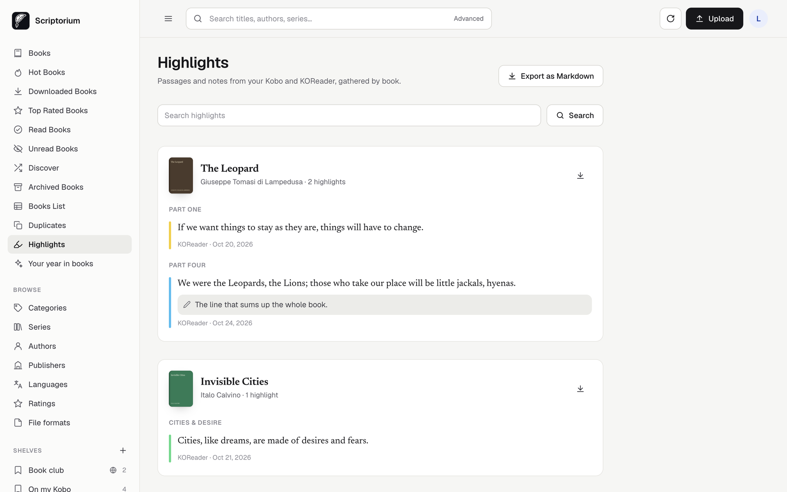
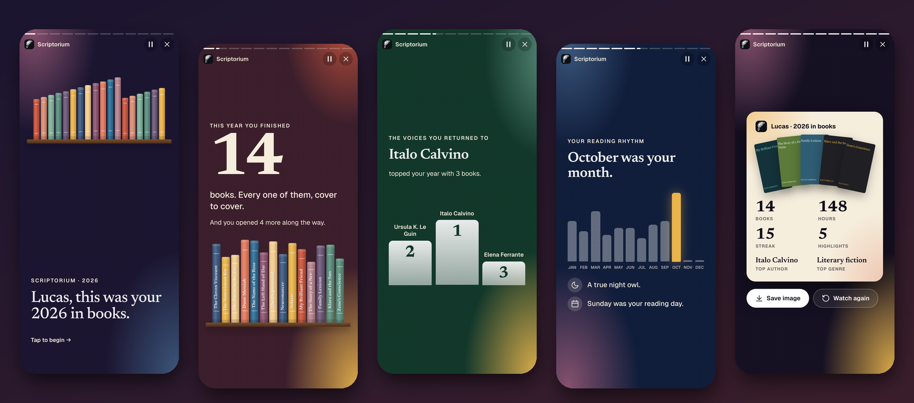
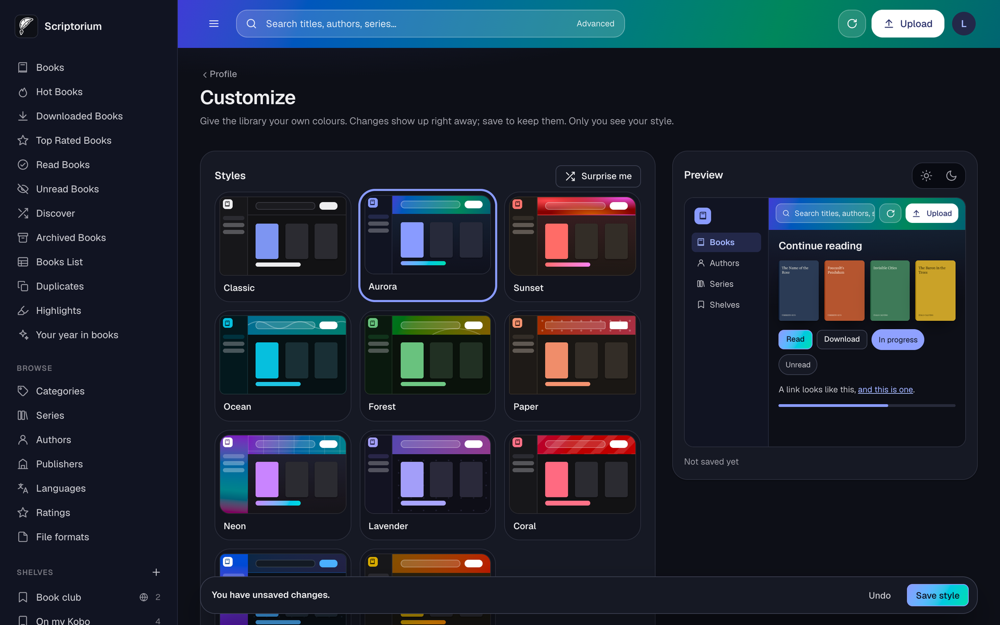

# Using Scriptorium

A tour of everything a reader can do, whether you run the server or someone set it up for you.

## Finding your way around

- **Sidebar** (bottom bar on a phone): your books, shelves and browsing.
- **Top bar**: search, *Upload* if you have the permission, and for administrators the update button.
- **Account menu** (your picture): *Profile*, *Devices*, *Customize*, *Install app*, *What's new*,
  *About*, *Appearance* and *Logout*.

Scriptorium is available in 28 languages. Pick yours under *Profile → Preferences → Interface
Language*.

## The home page

*Continue reading* shows the books in progress on your devices, with time left in each. Below it
are a few books to discover and then the whole library.

From the sidebar you can also open:

| Page | What it shows |
| --- | --- |
| **Hot Books** | The most downloaded books. |
| **Downloaded Books** | What you have downloaded. |
| **Top Rated Books** | The highest rated books. |
| **Read Books**, **Unread Books** | Sorted by your read status. |
| **Discover** | A random selection. |
| **Archived Books** | Books you have archived. See below. |
| **Books List** | A table for sorting and editing many books at once. |
| **Duplicates** | Possible duplicates, if you can edit books. See [Duplicates](automation.md#duplicates). |
| **Highlights** | Passages and notes from your e-reader. |
| **Reading statistics** | Reading time, streaks and habits from KOReader. |
| **Your year in books** | Your reading year as a story. |

*Browse* lists **Categories** (tags), **Series**, **Authors**, **Publishers**, **Languages**,
**Ratings** and **File formats**.

Your administrator can show or hide most of these. Each user can adjust them under
*Profile → Preferences*.

## Searching

Press `/` or `Ctrl+K` (`⌘K` on a Mac) anywhere to jump to search. **Advanced search** filters by
title, author, tags, series, language, rating, format, read status and more, and can include or
exclude each value.

## A book page

- **Read in Browser**: opens the reader. Audiobooks open a player that remembers where you stopped.
- **Download**: pick the format.
- **Send to eReader**: email it to your device. See [Kindle and email](ereaders.md#send-to-a-kindle-or-any-device-by-email).
- **Shelves**: add it to or remove it from shelves.
- **Edit**: change metadata, if you have the permission.
- **More**: *Mark As Read*, *Add to archive*, *Copy UUID* and, with permission, *Delete*.

The page also shows your reading progress with the device it came from, your highlights from this
book, and *More like this*: similar books from your own library, ranked by what they share, such
as authors, series and tags.

**Archiving** hides a book from the library without deleting it, and removes it from your Kobo at
the next sync. It only affects you. Unarchive it from *Archived Books*.

## Editing a book

*Edit* changes title, authors, series, tags, description, cover, identifiers and more.

- **Fetch Metadata** searches the online providers. Pick a result and review the fields before
  saving.
- **Convert book** converts it to another format, keeping the original.
- The identifier fields hold links such as ISBN or Hardcover ID. *Hardcover blacklist* stops
  automatic Hardcover matching for this book.

Your changes are written into the book file as well, so e-readers show the same details. See
[Cover and metadata enforcement](automation.md#metadata).

## Shelves

**Shelves** are lists you build by hand. Create one from the sidebar, add books from a book page,
and reorder them on the shelf page. Turn on *Share with Everyone* to make a shelf visible to all
users. *Sync this shelf with Kobo device* turns it into a collection on your Kobo.

**Smart shelves** fill themselves from rules. They stay current as your library changes, so you
never have to maintain them.

1. In the sidebar, create a smart shelf, or start from a template: *Recently Added*,
   *Highly Rated*, *Currently Reading*, *Yet to Read* or *Recent Publications*.
2. Add rules using fields such as title, author, tag, series, publisher, language, rating, read
   status, series number, publication date, date added, cover and Hardcover ID.
3. Choose whether **all** or **any** of the rules must match. Groups can be nested, so "science
   fiction AND (unread OR rated 4+)" is possible.
4. Press **Preview** to see the matching books, then save.

Dates accept `YYYY-MM-DD` or a number of days ago, so "added in the last 30 days" keeps rolling
forward.

## Reading in the browser

| Format | Reader |
| --- | --- |
| EPUB, KEPUB | Full reader with contents, bookmarks, four themes (Light, Sepia, Dark, Black), font and text size, one or two columns, fullscreen. |
| PDF | PDF viewer. |
| CBZ, CBR, CBT | Comic reader. |
| DjVu | DjVu viewer. |
| TXT | Text reader. |
| MP3, M4B, M4A, MP4, OGG, Opus, WAV, FLAC | Audiobook player. |

Your position is remembered for each book.

## Highlights

Every passage you highlight on your Kobo or in KOReader appears under **Highlights** after the next
sync, grouped by book and chapter, with your notes.

- Search across everything you have marked.
- Open a book to see only its highlights.
- **Export as Markdown** gives you a file ready for Obsidian, Notion or Readwise.

Highlights are private: only you see yours. Requirements for each device are in the [Kobo](kobo.md#highlights)
and [KOReader](koreader.md#highlights) guides.

## Reading statistics

With KOReader, **Reading statistics** in the sidebar shows how you read, gathered from all your
devices:

- time read today and this week, and your current and best streak of reading days;
- a calendar of the last year, shaded by how long you read each day;
- the last 30 days and the last 12 months as charts, and the hours and days you read most;
- your habits: total time, pages, sessions, the longest one and your pace;
- every book with the time you spent on it, how far you are and roughly how long is left.

Turn it on once on each device, as explained in [KOReader](koreader.md#reading-statistics). The
same statistics then appear in KOReader on all your devices.

## Your year in books

A full-screen story of your reading year. Tap to move forward, or let it play. It covers books
finished, hours reading, your first and last book, top authors and genres, your rhythm through the
year, a line you kept and your reader type. The last slide is a poster you can save and share.

Open it from the sidebar. It needs reading data from a connected device or an
[import](#import-from-goodreads-or-the-storygraph). If you have data from earlier years, you can
switch between them.

## Import from Goodreads or The StoryGraph

Bring your reading history instead of starting from zero.

1. Export a CSV:
   - **Goodreads**: *My Books → Import and export → Export Library*.
   - **The StoryGraph**: *Manage Account → Export StoryGraph Library*.
2. In Scriptorium, open *Profile → Reading history → Import* and choose the file.
3. Check the preview. Nothing changes until you confirm.

Books are matched to your library by ISBN, then by title and author. Finished books are marked as
read with their dates, and you choose what to do with books you are reading and your want-to-read
list. Books that are already marked as read stay read. Reviews and ratings are not imported, and
books you do not own are simply listed, not added.

## Customize

*Customize* in the account menu makes the interface yours. Choose one of eleven styles, press
*Surprise me*, or tune each colour in the palette editor with a live preview. *Appearance* switches
between System, Light and Dark.

Styles belong to your account, so they follow you to every device.

## Install it as an app

Scriptorium can be installed like a regular app. It opens full screen, has shortcuts to *Continue
reading*, *Highlights* and *Search*, and shows a friendly page when your server is out of reach.

| Device | How |
| --- | --- |
| Android (Chrome) | Account menu → *Install app*. |
| iPhone, iPad (Safari) | Share button → *Add to Home Screen*. |
| Desktop (Chrome, Edge) | Account menu → *Install app*. |

> [!IMPORTANT]
> Browsers only allow this over **HTTPS**, or on `localhost`. On a plain `http://192.168…` address,
> *Install app* will not work. See [Remote access](remote-access.md).

On Android, an installed app also appears in the system share menu. In any app or file manager,
choose *Share → Scriptorium* to send an ebook to the library. Your account needs the upload
permission.

## Your profile

| Tab | What is in it |
| --- | --- |
| **Account** | Username, email, password, linked sign-in accounts. |
| **Devices** | Which devices you read on, and their setup. |
| **eReaders** | Addresses for Send to eReader, and automatic sending. |
| **Reading history** | Reading card and import. |
| **Preferences** | Colours, languages, Hardcover token, what the sidebar shows. |
| **Shelves & OPDS** | Default order of the [OPDS catalogue](ereaders.md#reading-apps-opds). |

## What's new

After every update, a short *What's new* shows what changed. You can read it again at any time from
the account menu.
